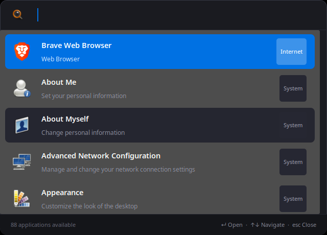

# Quick Launch 🚀

A premium, macOS Spotlight & Raycast inspired application launcher for Linux desktops (MATE, XFCE, and X11 environments).



## Highlights

- **Premium Spotlight Dark UI**: High-contrast dark canvas (`#1a1b20`), borderless search bar, clean Apple Cupertino blue selection, and hidden scrollbars designed for zero background bleed-through.
- **Instant Application Search**: Loads and queries desktop applications via native `Gio.AppInfo` in under 15ms.
- **Smart Learning & Frequency Scoring**: Tracks app usage (`~/.cache/quick-launch/history.json`) to automatically boost your most-used applications to the top.
- **Inline Calculator & Math Evaluation**: Type expressions like `1024 * 1024`, `sqrt(144)`, or `24 * 60` for immediate answers. Press Enter to copy the result to your clipboard.
- **Terminal Runner**: Prefix with `>` or `!` (e.g. `> htop`, `> ping 1.1.1.1`) to execute commands in your terminal.
- **Web Search Fallback**: Seamlessly search Google for any query directly from the launcher.
- **Category Badges**: Visual tags identifying utilities, development tools, system preferences, and media apps.
- **Full Keyboard Navigation**:
  - `↵ Enter`: Launch selected app / copy calculation / run command
  - `↑` / `↓` or `Ctrl+P` / `Ctrl+N`: Navigate results
  - `Esc`: Clear search input or close launcher
- **Zero Daemon Overhead**: Only runs on-demand when summoned; zero memory footprint when closed.

## Quick Install

```bash
git clone https://github.com/tanhank/quick-launch.git
cd quick-launch
./install.sh
```

The installer places the binary at `~/.local/bin/quick-launch` and automatically configures `Super` and `Super+Space` hotkeys in MATE Desktop.

## Manual Keybindings

For i3, Openbox, XFCE, or custom window managers:

- **Command**: `quick-launch`
- **Recommended Shortcut**: `Super` or `Super+Space`

## Uninstallation

```bash
./uninstall.sh
```
